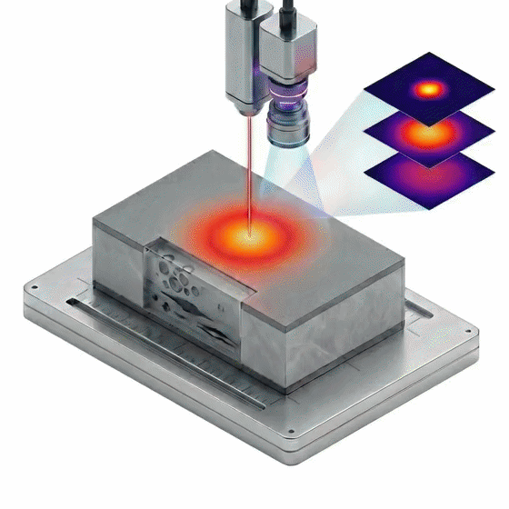
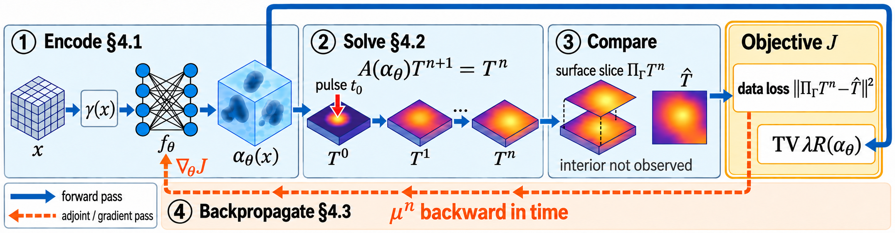

<div align="center">

# NeFTY: Neural Field Thermal Tomography

### A Differentiable Physics Framework for Non-Destructive Evaluation

[Tao Zhong](https://www.taozhong.info/), [Yixun Hu](https://yixun-hu.github.io/), [Dongzhe Zheng](https://scholar.google.com/citations?user=Szg1nBQAAAAJ&hl=en), [Aditya Sood](https://sites.google.com/view/adityasood/members?authuser=0#h.kqvdn7sywamh), [Christine Allen-Blanchette](https://cablanc.github.io/)

Princeton University

**NeurIPS 2026**

[](https://cab-lab-princeton.github.io/nefty/)
[](https://arxiv.org/abs/2603.11045)
[](https://huggingface.co/datasets/n3il666/NeFTY)
[-green)](#license)
[](https://www.python.org/)
[](https://pytorch.org/)



<em>A high-speed camera records the transient surface temperature after a pulsed laser heats the specimen.<br>NeFTY reconstructs the 3D subsurface diffusivity field from these measurements and reveals the hidden defects.</em>

</div>

## Overview

Recovering a 3D thermal diffusivity field from surface thermograms is a severely ill-posed inverse heat conduction problem: diffusion damps high-frequency interior structure before it reaches the surface. NeFTY represents the unknown diffusivity as a coordinate-based neural field and, at every optimization step, passes the candidate field through a differentiable implicit-Euler heat solver with harmonic-mean interface flux, so the simulated temperature satisfies the discretized heat equation up to the solver tolerance. Because the temperature is computed from the diffusivity, the surface data term constrains the diffusivity directly. Adjoint gradients carry the surface reconstruction error back to the network weights at solver-level memory cost, which makes label-free, per-specimen inversion tractable on a single GPU.

<p align="center">
  
</p>

**Pipeline.** (1) Encode: a coordinate MLP maps each grid node through a frequency-annealed positional encoding into a bounded diffusivity. (2) Solve: a differentiable implicit-Euler solver with harmonic-mean coefficients evolves the temperature on a Cartesian grid. (3) Compare: only the surface slice of the temperature is compared to the measurements, and a total-variation regularizer acts on the diffusivity. (4) Backpropagate: the adjoint state is propagated backward in time through the same sparse system to assemble the gradient on the network weights.

**Results.** Label-free 3D diffusivity reconstruction on the synthetic 1,000-sample benchmark, reproduced from Table 1 of the paper (mean ± 95% CI, MSE in units of 10<sup>-4</sup>, best label-free entry per metric in bold) for the methods included in this repository:

| Method | Homog. MSE ↓ | Homog. PSNR ↑ | Homog. SSIM ↑ | Homog. IoU ↑ | Layered MSE ↓ | Layered PSNR ↑ | Layered SSIM ↑ | Layered IoU ↑ |
|---|---|---|---|---|---|---|---|---|
| U-Net (Sound-Only), data-driven zero-shot | 14.73 ± 3.83 | 14.83 ± 0.71 | 0.83 ± 0.02 | 0.00 ± 0.00 | 10.17 ± 2.21 | 15.42 ± 0.98 | 0.88 ± 0.02 | 0.00 ± 0.00 |
| PINN (GradNorm) | 208.4 ± 26.2 | -0.24 ± 0.06 | 0.04 ± 0.00 | 0.015 ± 0.003 | 200.4 ± 17.8 | 1.42 ± 0.27 | 0.04 ± 0.00 | 0.018 ± 0.004 |
| Grid Opt. | 12.61 ± 4.20 | 13.99 ± 1.18 | 0.56 ± 0.04 | 0.04 ± 0.02 | 15.01 ± 2.97 | 13.27 ± 0.88 | 0.57 ± 0.04 | 0.03 ± 0.01 |
| **NeFTY (ours)** | **3.66 ± 1.31** | **18.48 ± 0.53** | **0.77 ± 0.02** | **0.45 ± 0.04** | **9.26 ± 2.81** | **15.88 ± 0.79** | **0.74 ± 0.03** | **0.37 ± 0.06** |

The paper additionally compares against SPINN, Causal-PINN, DCGD, and classical L-BFGS voxel inversion, and evaluates on real PVC thermography, where NeFTY is the best label-free method for both 2D defect segmentation (IoU 0.431, Dice 0.597) and 2.5D depth estimation (Abs Rel 0.465).

## News

- NeFTY is accepted to NeurIPS 2026.
- Code, the synthetic benchmark, and the pretrained Sound-Only U-Net are released.

## Contents

- [Installation](#installation)
- [Data](#data)
- [Quick start](#quick-start)
- [Reproducing the paper](#reproducing-the-paper)
- [Outputs and metrics](#outputs-and-metrics)
- [Repository structure](#repository-structure)
- [Citation](#citation)
- [Acknowledgements](#acknowledgements)

## Installation

```bash
git clone https://github.com/CAB-Lab-Princeton/NeFTY-code.git
cd NeFTY-code

conda env create -f environment.yml
conda activate nefty
# or, in an existing Python 3.10 environment:
# pip install -r requirements.txt
```

`requirements.txt` pins the tested versions: PyTorch 2.9.1 (CUDA 12.8 wheels), NumPy 2.2.6, SciPy 1.15.3, scikit-image 0.25.2, Matplotlib 3.10.8, PhiFlow 3.4.0 / PhiML 1.14.3, ConfigArgParse 1.7.1, and huggingface_hub 2.3.0. PhiFlow is only needed to generate data. Each reconstruction runs on a single GPU.

## Data

### Download

The benchmark, the defect-free training set for the Sound-Only U-Net, and the pretrained U-Net checkpoint are hosted on Hugging Face at [`n3il666/NeFTY`](https://huggingface.co/datasets/n3il666/NeFTY).

```bash
python scripts/download_data.py                     # everything
python scripts/download_data.py --what benchmark    # any of: benchmark defect_free unet
python scripts/download_data.py --dry_run           # print what goes where
```

| Item | Local path | Size |
|---|---|---|
| Synthetic benchmark (1,000 samples) | `data/synthetic_1000/dataset.pt` | 3.8 GB |
| Defect-free set (1,000 samples, Sound-Only U-Net training) | `data/synthetic_1000_nodefect/dataset.pt` | 3.8 GB |
| Pretrained Sound-Only U-Net | `checkpoints/unet_sound_only.tar` | 84 MB |
| Mini dataset (8 samples, tracked in git) | `data/synthetic_test/dataset.pt` | 31 MB |

The mini dataset holds seven homogeneous specimens and one three-layer specimen for quick checks. SHA-256 checksums of the hosted files are listed on the [dataset card](https://huggingface.co/datasets/n3il666/NeFTY).

### Benchmark

Ground truth is simulated with PhiFlow, a finite-volume engine independent of the NeFTY solver, so reconstructions are not evaluated against data produced by their own discretization. Each sample lives on the unitless slab [0, 10]<sup>2</sup> × [0, 1] at 64 × 64 × 16 resolution, with periodic lateral boundaries and adiabatic top and bottom faces. The surface is recorded for 100 frames at Δt = 0.05 after a Gaussian post-flash initial condition. Bulk diffusivity is drawn from U(0.1, 0.2), and each sample contains one to four ellipsoidal, cylindrical, or box-shaped subsurface defects with diffusivity drawn from U(0.005, 0.015).

| Setting | Indices | Samples |
|---|---|---|
| Homogeneous, 1 defect (`1_defect`) | 0-199 | 200 |
| Homogeneous, 2 defects (`2_defect`) | 200-399 | 200 |
| Homogeneous, 3 defects (`3_defect`) | 400-600 | 201 |
| Homogeneous, 4 defects (`4_defect`) | 601-799 | 199 |
| Layered, 3 layers (`3_layer`) | 800-900 | 101 |
| Layered, 4 layers (`4_layer`) | 901-999 | 99 |

The generator assigns categories from the fractional index i / 1000 in floating point, which places samples 600 and 900 in the preceding bucket. Within each layered group, the defect count runs 1, 2, 3, 4 in blocks of about 25 samples. The defect-free set uses the same bulk layout without defects (0-799 homogeneous, 800-900 three layers, 901-999 four layers). The setting names in parentheses are the ones used by the batch drivers.

### Format

Each `dataset.pt` is a dictionary saved with `torch.save`. Load it with `torch.load(path)` or with `dataset.synthetic.load_synthetic_dataset(path)`, which accepts the file or its directory.

| Key | Shape | dtype | Content |
|---|---|---|---|
| `k_gt` | (N, 64, 64, 16) | float32 | ground-truth diffusivity on the (x, y, z) cell-center grid |
| `t0_gt` | (N, 64, 64, 16) | float32 | initial temperature (Gaussian post-flash profile) |
| `surface_gt` | (N, 101, 64, 64) | float32 | observed top-surface temperature, frames 0 to 100 (equal to `surface_gt_phiflow`) |
| `surface_gt_phiflow` | (N, 101, 64, 64) | float32 | PhiFlow ground-truth surface temperature |
| `surface_gt_ours` | (N, 101, 64, 64) | float32 | NeFTY solver's forward prediction at `k_gt` (reference only) |
| `resolution` | dict | | `{'x': 64, 'y': 64, 'z': 16}` |

The surface tensors store the initial frame followed by the 100 recorded frames. The defect-free set also stores `domain_size`, and datasets generated with this code additionally record `dt` and `num_steps` (and `domain_size`). Some files carry a stale `time_steps` entry (51 in the benchmark), which `load_synthetic_dataset` replaces with the frame count of `surface_gt`.

### Regenerating the data

```bash
python -m dataset.synthetic --out_dir ./data/synthetic_1000 --num_samples 1000 --seed 42
python -m dataset.generate_defect_free --out_dir ./data/synthetic_1000_nodefect --num_samples 1000 --seed 42
# or both at once (env: NUM_SAMPLES, SEED, DATA_ROOT, GEN_ARGS, DEFECT_FREE_ARGS):
bash scripts/generate_data.sh
```

With `--seed 42` both generators reproduce the hosted `k_gt` fields exactly. The PhiFlow surfaces depend on the GPU or CPU used. The generators also accept `--resolution X Y Z`, `--num_steps`, `--dt`, and `--cpu` (`dataset.synthetic` additionally takes `--domain LX LY LZ`, `--batch_size`, and `--no_vis`), and write `<out_dir>/dataset.pt`. PhiFlow integrates explicitly with adaptive sub-stepping, so generating 1,000 samples is compute-heavy. `generate_defect_free.py` simulates all samples in a single PhiFlow batch, which needs a large-memory GPU at N = 1000. Both generators stop with an error if PhiFlow is not installed or a PhiFlow batch fails. `--no_phiflow` uses the NeFTY solver for the observations instead (an inverse-crime setting, for debugging only; no `surface_gt_phiflow` key is written).

## Quick start

The smoke tests and the quick configurations run on the bundled mini dataset, so no download is needed.

```bash
pytest -q          # solver, adjoint gradient checks, data generation, training steps, CLI round trips, batch helpers

# NeFTY on one specimen (20 iterations, no torch.compile), then evaluation
python train.py --config configs/quick/nefty.txt --eval_idx 0
python evaluate.py --checkpoint logs/nefty_quick/best.tar

# Grid Opt. and PINN (GradNorm)
python train.py --config configs/quick/grid_opt.txt --eval_idx 0
python train_pinn.py --config configs/quick/pinn_gradnorm.txt --eval_idx 0
python evaluate_pinn.py --checkpoint logs/pinn_gradnorm_quick/final.tar

# Pretrained Sound-Only U-Net (after `python scripts/download_data.py --what unet`)
python evaluate_unet.py --checkpoint checkpoints/unet_sound_only.tar --eval_idx 0 --datadir ./data/synthetic_test
```

`CUDA_VISIBLE_DEVICES="" pytest -q` forces the tests onto the CPU.

## Reproducing the paper

Every method is configured by a plain-text file in `configs/`. Command-line flags override config values.

| Method | Config | Train | Evaluate | Batch (train + evaluate + aggregate) |
|---|---|---|---|---|
| NeFTY | `configs/nefty.txt` | `train.py` | `evaluate.py` | `bash scripts/train_batch.sh` |
| Grid Opt. | `configs/grid_opt.txt` | `train.py` | `evaluate.py` | `CONFIG=configs/grid_opt.txt bash scripts/train_batch.sh` |
| PINN (GradNorm) | `configs/pinn_gradnorm.txt` | `train_pinn.py` | `evaluate_pinn.py` | `CONFIG=configs/pinn_gradnorm.txt bash scripts/train_pinn_batch.sh` |
| PINN, fixed loss weights (alternative recipe) | `configs/pinn.txt` | `train_pinn.py` | `evaluate_pinn.py` | `CONFIG=configs/pinn.txt bash scripts/train_pinn_batch.sh` |
| U-Net (Sound-Only) | `configs/unet_sound_only.txt` | `train_unet.py` | `evaluate_unet.py` | `bash scripts/train_unet_sound_only.sh` |

Grid Opt. is the NeFTY configuration with the neural field replaced by a voxel grid (`use_grid = True`). It shares the solver, the adjoint, and the TV regularizer with NeFTY and therefore isolates the contribution of the neural-field prior. `configs/quick/` holds 20-iteration (2-epoch for the U-Net) variants of every config for smoke tests.

`configs/pinn.txt` is an alternative PINN recipe: besides fixed loss weights (no GradNorm), it uses a ReLU diffusivity network, raw physical coordinates as network inputs, and a learning rate of 1e-4.

This release covers NeFTY and the Grid Opt., PINN, and Sound-Only U-Net baselines on the synthetic benchmark. For the published PINN variants we compare against in the paper (SPINN, Causal-PINN, and DCGD), please use the authors' official implementations.

### Single specimen

NeFTY, Grid Opt., and the PINN reconstruct one specimen per run, selected with `--eval_idx`.

```bash
# NeFTY
python train.py --config configs/nefty.txt --eval_idx 150 --expname nefty_150
python evaluate.py --checkpoint logs/nefty_150/best.tar

# Grid Opt.
python train.py --config configs/grid_opt.txt --eval_idx 150 --expname grid_150
python evaluate.py --checkpoint logs/grid_150/best.tar

# PINN (GradNorm). For fixed loss weights, use configs/pinn.txt
python train_pinn.py --config configs/pinn_gradnorm.txt --eval_idx 150 --expname pinn_150
python evaluate_pinn.py --checkpoint logs/pinn_150/final.tar
```

Training runs for `N_iters` steps. `best.tar` is selected by surface-temperature PSNR, so checkpoint selection uses no volumetric labels. The paper configs enable `torch.compile` (`use_compile = True`), and the first step compiles the solver. Pass `--use_compile False` to skip compilation for short runs. Other useful flags are `--gpu <id>` (sets `CUDA_VISIBLE_DEVICES`; command line only, not read from config files), `--datadir`, `--basedir`, and `--N_iters`. The evaluators accept `--datadir` to override the dataset path stored with the run and `--output_dir` to redirect their outputs.

### Sound-Only U-Net

The U-Net is trained once on the defect-free set and evaluated per specimen on the defect benchmark. By default, training leaves out a fixed list of 240 indices of the defect-free set (`HELD_OUT_INDICES` in `network/trainer_unet.py`; `--use_holdout False` trains on all samples), and the pretrained checkpoint was trained this way on the remaining 760 samples. Train it from scratch, or evaluate the pretrained checkpoint directly:

```bash
# Train from scratch on the defect-free set, then evaluate one specimen
python train_unet.py --config configs/unet_sound_only.txt
python evaluate_unet.py --checkpoint logs/unet_sound_only/best.tar --eval_idx 150 --datadir ./data/synthetic_1000

# Pretrained checkpoint (its training arguments are stored in the checkpoint)
python evaluate_unet.py --checkpoint checkpoints/unet_sound_only.tar --eval_idx 150 --datadir ./data/synthetic_1000
```

U-Net evaluation re-simulates the surface temperature with the benchmark settings (10 × 10 × 1 domain, 64 × 64 × 16 grid, 101 frames at Δt = 0.05, Gaussian initial condition) and stops with an error if the dataset's shapes or recorded settings differ.

### Full benchmark

The batch drivers train and evaluate every specimen of the 1,000-sample benchmark, distributing one process per specimen over the listed GPUs, and then aggregate the metrics.

```bash
bash scripts/train_batch.sh                                        # NeFTY
CONFIG=configs/grid_opt.txt bash scripts/train_batch.sh            # Grid Opt.
CONFIG=configs/pinn_gradnorm.txt bash scripts/train_pinn_batch.sh  # PINN (GradNorm)
bash scripts/train_unet_sound_only.sh                              # U-Net: train on the defect-free set, then evaluate

# Pretrained U-Net, evaluation only
python evaluate_unet_batch.py --checkpoint checkpoints/unet_sound_only.tar --datadir ./data/synthetic_1000
```

The shell scripts take no arguments; they are configured through environment variables, and every stage (training, evaluation, aggregation) uses the same settings:

- `GPUS` (default `0,1`), `MAX_PER_GPU` (concurrent specimens per GPU, default `20`, sized for 96 GB GPUs), `OUTPUT_ROOT`, `PYTHON`
- `INDICES` (space-separated sample indices), `SETTINGS` (any of `1_defect 2_defect 3_defect 4_defect 3_layer 4_layer`), `DATASET_SIZE` (default: the size recorded in `OUTPUT_ROOT/tasks.json`, else `1000`; for another dataset, all N samples are run and each index is assigned to its category)
- `DRY_RUN=1` prints the commands of every stage without running anything
- `train_batch.sh` / `train_pinn_batch.sh`: `CONFIG`, `DATA_DIR`, `SEED`, `TRAIN_ARGS` (extra arguments for the training script, e.g. `"--N_iters 100"`)
- `train_unet_sound_only.sh`: `CONFIG`, `TRAIN_DATA_DIR` (defect-free set), `EVAL_DATA_DIR` (benchmark), `SEED`, `GPU` (training GPU), `EXPNAME`, `BASEDIR`, `TRAIN_ARGS`

Training records the selected tasks in `<OUTPUT_ROOT>/tasks.json`, and evaluation and aggregation use the same selection, so a report's "requested" count is exactly the selected specimens. The scripts stop at the first failing stage, and an interrupted batch (Ctrl-C or SIGTERM) terminates its processes and exits with a nonzero status. Lower `MAX_PER_GPU` on smaller GPUs. Each U-Net evaluation process loads the full benchmark file, so host memory also bounds its concurrency.

```bash
# Only the layered specimens
SETTINGS="3_layer 4_layer" bash scripts/train_batch.sh

# Two specimens of the mini dataset on one GPU (drop INDICES to run all 8)
CONFIG=configs/quick/nefty.txt DATA_DIR=./data/synthetic_test GPUS=0 MAX_PER_GPU=1 \
  INDICES="0 7" DATASET_SIZE=8 bash scripts/train_batch.sh
```

The Python entry points behind the scripts are `train_batch.py` (`--script train.py` or `--script train_pinn.py`), `evaluate_batch.py`, `evaluate_pinn_batch.py`, and `evaluate_unet_batch.py`. They take the same options as flags (`--gpus`, `--max_per_gpu`, `--dry_run`, `--indices`, `--settings`, `--dataset_size`). Without a selection, `evaluate_batch.py` and `evaluate_pinn_batch.py` use the batch's recorded `tasks.json`, and `--all_found` evaluates every run directory found under `--output_root`. `OUTPUT_ROOT=<dir> METHOD=nefty|pinn bash scripts/evaluate_batch.sh` re-runs evaluation for an existing batch (`ALL_FOUND=1` maps to `--all_found`), and `METRICS_ONLY=1` (or `--metrics_only` on the Python evaluators) only re-aggregates existing `metrics.txt` files.

## Outputs and metrics

A single NeFTY or Grid Opt. run writes `args.txt`, `best.tar`, and `final.tar` to `<basedir>/<expname>/`, and a PINN run writes `args.txt` and `final.tar`. Evaluation writes `output_visualization/metrics.txt` next to the checkpoint, together with `diffusivity_combined.png` (ground-truth and reconstructed diffusivity slices), `surface_temperature_time.png`, and `error_distribution.png`. `evaluate_unet.py` writes the same files to `<checkpoint dir>/eval_<idx>/` unless `--output_dir` is given.

A batch run produces `<output_root>/<setting>/idx_<i>/` per specimen, a `metrics_report.txt` per setting, and a consolidated `<output_root>/metrics_report.txt`. The consolidated report has a "Not layered" block (800 specimens, the Homogeneous columns of Table 1) and a "Layered (3_layer, 4_layer)" block (200 specimens), each reporting the mean ± 95% confidence interval (1.96 × sample standard deviation / √n) of:

- **Diffusivity**: MSE, MAE, PSNR, SSIM (computed slice by slice along z and averaged), and volumetric IoU between the defect masks {α < 0.03} of the reconstruction and the ground truth.
- **Surface temperature**: MSE and MAE over all frames, MSE at the final frame, PSNR over all frames and at the final frame, and SSIM at the final frame.

Table 1 of the paper reports MSE, PSNR, SSIM, and IoU. The metric implementations are in `utils/metrics.py`. The U-Net evaluator writes `k_mse`, `k_mae`, `k_max_error`, `k_psnr`, `k_ssim`, `k_iou` (diffusivity) and `surface_mse`, `surface_psnr_final`, `surface_psnr_overall` (surface temperature of the re-simulated prediction), and its reports use these names.

Each report starts with the number of requested, evaluated, missing, failed (evaluation errors in the current run; their old outputs are ignored), and excluded specimens. Non-finite values are left out of the means and counted, and a `WARNING` line marks reports with missing or failed specimens or missing metrics. An optional `<output_root>/outliers.txt` (one `<setting>/idx_<i>` per line) excludes runs from the aggregates.

## Repository structure

```
NeFTY-code/
├── configs/                     # paper configs (nefty, grid_opt, pinn_gradnorm, pinn, unet_sound_only)
│   └── quick/                   # 20-iteration / 2-epoch smoke-test variants
├── data/synthetic_test/         # 8-sample mini dataset
├── dataset/
│   ├── synthetic.py             # benchmark generator (PhiFlow ground truth) and loader
│   └── generate_defect_free.py  # defect-free set for the Sound-Only U-Net
├── network/
│   ├── sim/simulator.py         # differentiable implicit-Euler heat solver (Jacobi inner solve)
│   ├── sim/adjoint.py           # discrete adjoint backward pass
│   ├── net/thermo_nerf.py       # diffusivity field: MLP with positional encoding, or voxel grid
│   ├── net/embedder.py          # positional encoding with frequency annealing
│   ├── net/thermo_nerf_pinn.py  # PINN temperature and diffusivity networks
│   ├── net/thermal_unet.py      # 3D U-Net (GPL-3.0, adapted from Pytorch-UNet)
│   ├── trainer.py               # NeFTY / Grid Opt. trainer
│   ├── trainer_pinn.py          # PINN trainer (optional GradNorm)
│   └── trainer_unet.py          # U-Net trainer
├── scripts/                     # download, data generation, and batch shell wrappers
├── tests/test_smoke.py          # smoke tests
├── utils/                       # metrics, plotting, batch helpers
├── train.py, evaluate.py                  # NeFTY and Grid Opt.
├── train_pinn.py, evaluate_pinn.py        # PINN
├── train_unet.py, evaluate_unet.py        # U-Net
├── train_batch.py                         # batch training (NeFTY, Grid Opt., PINN)
├── evaluate_batch.py, evaluate_pinn_batch.py, evaluate_unet_batch.py
├── LICENSES/GPL-3.0.txt, THIRD_PARTY_NOTICES.md   # license of network/net/thermal_unet.py
└── requirements.txt, environment.yml, pytest.ini, CITATION.cff, LICENSE
```

## Citation

If you find this work useful, please cite:

```bibtex
@inproceedings{zhong2026nefty,
  title     = {Neural Field Thermal Tomography: A Differentiable Physics Framework for Non-Destructive Evaluation},
  author    = {Zhong, Tao and Hu, Yixun and Zheng, Dongzhe and Sood, Aditya and Allen-Blanchette, Christine},
  booktitle = {Advances in Neural Information Processing Systems (NeurIPS)},
  year      = {2026}
}
```

## Acknowledgements

Ground-truth data are generated with PhiFlow (Holl and Thuerey, ICML 2024). The positional encoding follows NeRF (Mildenhall et al.), and the frequency-annealing schedule follows Nerfies (Park et al., ICCV 2021). The PINN baseline builds on Raissi et al. (2019) and GradNorm (Chen et al., ICML 2018). We thank the authors of SPINN (Cho et al., NeurIPS 2023), Causal-PINN (Wang et al., 2024), and DCGD (Hwang and Lim, NeurIPS 2024) for releasing their code. This project is partially supported by the AI Lab Seed Grant from the Princeton Laboratory for Artificial Intelligence.

## License

This code is released under the [MIT License](LICENSE), except `network/net/thermal_unet.py`, which adapts the U-Net blocks of [Pytorch-UNet](https://github.com/milesial/Pytorch-UNet) and is distributed under [GPL-3.0](LICENSES/GPL-3.0.txt). See [THIRD_PARTY_NOTICES.md](THIRD_PARTY_NOTICES.md).

## Contact

For questions, please contact [Tao Zhong](https://www.taozhong.info/) (tzhong@princeton.edu) or open an issue.
